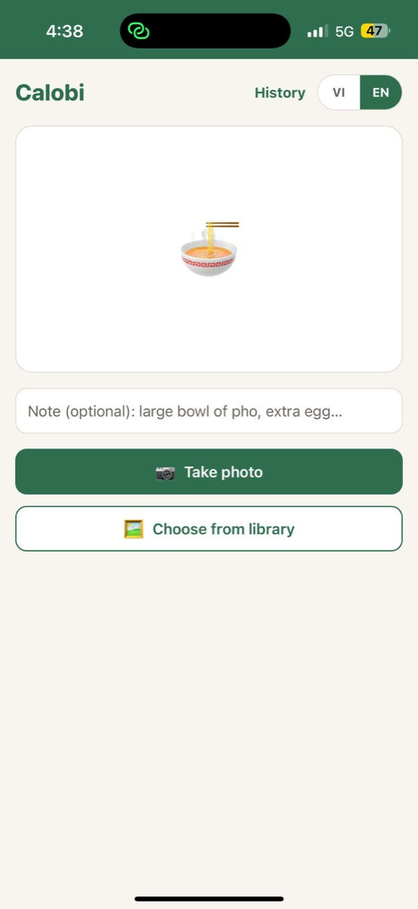
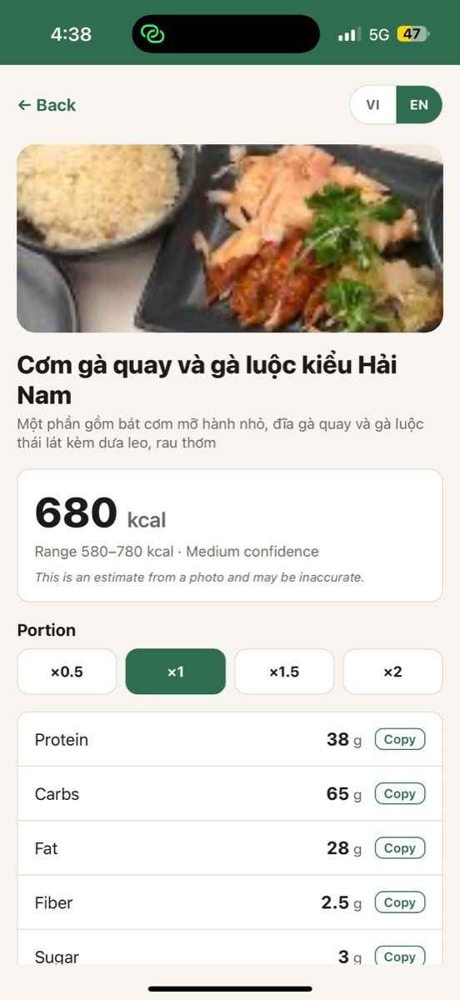
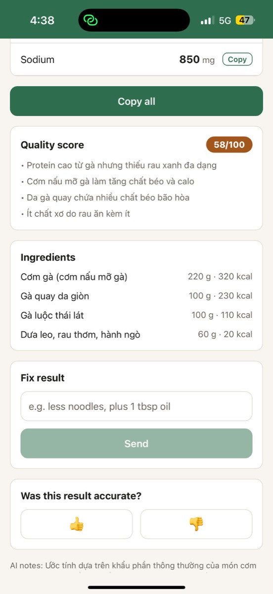

# Calobi

Snap a photo of your meal and get an AI estimate of its calories and nutrients,
ready to copy into whatever tracker you already use. No account, no paywall, and
Vietnamese dishes first.

**Live demo:** https://calobi.johnny-bui1911.workers.dev (best on a phone; add it
to your home screen to use it like an app).

| Scan | Result | Details |
|:---:|:---:|:---:|
|  |  |  |

## What it does

- **One photo, full estimate.** Total kcal with a range and confidence level,
  protein, carbs, fat, fiber, sugar and sodium.
- **Copy on tap.** Each number copies on its own, or use "Copy all" for a
  formatted summary.
- **Portion multiplier.** Switch between ×0.5, ×1, ×1.5 and ×2 instantly on the
  device.
- **Quality score.** A 0–100 rating with short reasons, plus a per-ingredient
  breakdown.
- **Fix result.** Correct the estimate in one sentence ("less noodles, plus 1 tbsp
  oil") without taking a new photo.
- **Built for Vietnamese food.** The prompt accounts for the hidden oil, broth
  fat and sauce sugar that other apps tend to underestimate.
- **Private by default.** No sign-up, and history stays on your device. Photos are
  never stored on a server.
- **Vietnamese and English**, detected from the device and switchable in the app.

Every result is an estimate from a photo, and the app says so.

## How it works

An Expo (React Native) app exported for the web and installable as a PWA. One
Cloudflare Worker serves the app and proxies `/api/*` to Claude, so the API key
never reaches the browser. The Worker also enforces burst and daily quotas and
records anonymous feedback in Workers Analytics Engine.

```
Phone browser ──► Cloudflare Worker ──► Claude API
   (Expo web)      ├─ static assets
                   ├─ /api/scan, /api/refine, /api/feedback
                   └─ quotas (Durable Object)
```

## Getting started

Requirements: Node.js, an Anthropic API key, and a Cloudflare account for
deploys.

```bash
npm install
echo "ANTHROPIC_API_KEY=sk-ant-..." > .dev.vars   # local only, gitignored
npx wrangler types
npx expo export -p web && npx wrangler dev --port 8787
```

Then open http://localhost:8787. Run `npm test` for unit tests.

Releases run through one script, `scripts/release.sh`, which tests, builds,
deploys and smoke-tests production. See the
[deployment guide](docs/deployment-guide.md) before the first release.

## Documentation

| Document | Read it for |
|---|---|
| [Project overview](docs/project-overview-pdr.md) | Product intent, positioning and non-goals |
| [System architecture](docs/system-architecture.md) | Runtime boundaries and key decisions |
| [Codebase summary](docs/codebase-summary.md) | Where each concern lives |
| [Deployment guide](docs/deployment-guide.md) | Local development, release, secrets, logs and rollback |
| [Roadmap](docs/project-roadmap.md) | Where the project is heading |
